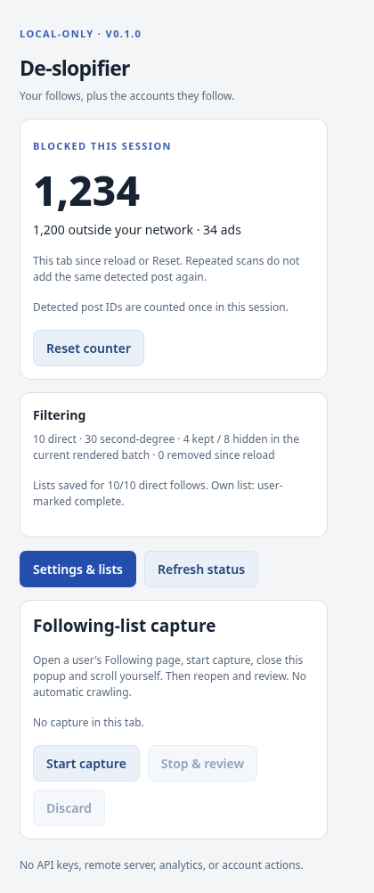

# De-slopifier

**Your feed. Your circle.**

A Chromium and Firefox extension that filters X's **For You** feed using your
following network, optionally hides detected promoted posts, and shows how many
posts it has blocked in the current tab session.

```text
You follow Alice  → Alice's posts stay
Alice follows Bob → Bob's posts stay
Bob follows Eve   → Eve does not qualify through this connection
```

This is a relationship-based author filter, not an AI-content detector or a quality
score. Following lists must be pasted, imported, or captured and reviewed locally.
It does **not** automatically download or refresh your entire social graph.

> **Prototype:** incomplete lists can hide eligible authors. Current live X selectors,
> real ads, and Firefox runtime compatibility have not been verified. Fixture test
> results do not establish live compatibility. See [TESTING.md](TESTING.md).

## Session blocked-post counter

Open the toolbar popup to see **Blocked this session**, split into **outside your
network** and **ads**. The popup refreshes while open. This is cumulative across
scrolling, not just the currently mounted batch of posts.

A session means **this X tab since its last full page load or Reset**. Closing and
reopening the popup or navigating inside X does not reset it. Reloading X, closing
the tab, or clicking **Reset counter** starts over. It is not browser-wide and does
not persist through a reload. Detected post IDs are counted once; without an ID,
mounted-card identity is used and the popup reports those entries as estimates.
A remounted card without a stable ID may be counted again.

Reset seeds already-mounted blocked cards without immediately counting them again.
The breakdown records the reason a post was first counted. Hiding and experimental
HTML removal both contribute to the counter.



## Optional promoted-post hiding

In **Settings & lists**, enable **Hide detected ads / promoted posts**. It is checked
by default but does nothing until **Enable filtering** is turned on. Ads can be
hidden even when your following graph is not ready; the popup explains that it is
in **Ads only** mode. Ads from followed authors are excluded too.

This is **best-effort DOM hiding**, not disabling ads on your X account. It targets
recognized promotion markers and single-post placement wrappers in the Home feed.
It deliberately does not treat ordinary post text saying “Ad” or a quoted promotion
marker as sufficient. Changing X markup, other languages, video formats, sidebar
ads, profile ads and other placements may not be covered. It neither blocks every
ad request nor guarantees that impressions are not recorded.

## Install

<!-- STORE_LINKS_START -->
**Chrome Web Store: not published yet.** There is no verified De-slopifier store
installation URL yet. [Publisher setup](docs/PUBLISHING.md).

**Firefox Add-ons: not published yet.** Use the unsigned local build for testing,
not as a permanent signed add-on. [Publisher setup](docs/PUBLISHING.md).
<!-- STORE_LINKS_END -->

After the repository and its first Release workflow exist, numbered builds are at
[GitHub Releases](https://github.com/BDR-Pro/De-slopifier/releases/latest), and the
[newest successful main preview](https://github.com/BDR-Pro/De-slopifier/releases/tag/rolling)
has fixed download assets. These paths are prospective until setup succeeds.
A GitHub release does not imply approval by either browser store.

### Chrome / Chromium / Edge / Brave

Extract the complete project archive and open `chrome://extensions`. Turn on
**Developer mode**, choose **Load unpacked**, and select **`dist/chromium`** inside
this project. Reload X. Edge uses `edge://extensions`; Brave uses `brave://extensions`.

With a standalone `*-chromium.zip`, extract it and select the extracted directory
that directly contains `manifest.json`. Do not select the ZIP itself. Unpacked
installations require you to replace/rebuild files and click **Reload** for updates.

[Google's installation guide](https://developer.chrome.com/docs/extensions/get-started/tutorial/hello-world#load-unpacked).

### Firefox 140+

Open `about:debugging#/runtime/this-firefox`, click **Load Temporary Add-on**, and
select **`dist/firefox/manifest.json`**. Allow site access when prompted and reload X.
For a standalone Firefox ZIP, extract it and select its root `manifest.json`.

The included Firefox package is **unsigned**. A temporary installation is removed
when Firefox restarts. A permanent normal installation requires AMO or a Mozilla-signed
XPI. Renaming a ZIP does not sign it. Export your graph before switching installations.

[Mozilla's temporary-installation guide](https://extensionworkshop.com/documentation/develop/temporary-installation-in-firefox/).

## First-time setup

1. Open **Settings & lists**, enter your X handle, and save.
2. On your `x.com/YOUR_HANDLE/following` page, select **Start capture**, close the
   popup and scroll yourself, then **Stop & review**. Remove mistakes/suggestions
   and **Save / replace list**. Pasting or JSON import is also supported.
3. Add Following lists for your direct follows for second-degree coverage. Enable
   filtering and return to For You.

For ads-only testing you can enable filtering and ad hiding without saving a graph.
For network filtering your configured handle must match the detected signed-in
account. Quotes are classified by the outer author; reposts by their original author,
not the reposter. Mentions never grant access. See [full usage notes](docs/USAGE.md).

## Build / compile from source

There is **no JavaScript compilation or npm install** required to build the extension.
Python 3.10+ copies the readable HTML/CSS/JS, writes the browser-specific manifest,
and packages it. Icons are already bundled. No runtime/build dependencies or server.

From the extracted project directory:

```bash
python3 build.py
```

Windows PowerShell: `py -3 build.py`. From GitHub, once the repository exists:

```bash
git clone https://github.com/BDR-Pro/De-slopifier.git
cd De-slopifier
python3 build.py
```

```text
dist/chromium/    Load unpacked in Chromium
dist/firefox/     Load temporarily in Firefox
dist/release/    Browser ZIPs, matching source ZIP, SHA256SUMS
```

ZIP metadata is fixed and entries are uncompressed, so identical source files
produce identical ZIP bytes. Do not commit generated `dist/` files to the repository.

## Tests

Node.js 22+ is used for tests and Mozilla's publishing tool, not for the extension build.

```bash
node --test tests/test_core.cjs
python3 -m unittest discover -s tests -p 'test_tooling*.py' -v
```

Optional Chromium fixtures use Playwright:

```bash
python3 -m pip install -r requirements-test.txt
python3 -m playwright install chromium
python3 tests/test_browser.py
```

Set `CHROMIUM_EXECUTABLE` to use a system Chromium binary. X HTML, navigation and
extension APIs are mocked. No account or publishing credentials are needed.

## GitHub repository and release setup

Prepared for the **public** repository `BDR-Pro/De-slopifier`. The source package
includes a bootstrap; it does not mean the remote repository already exists.
Install Git, GitHub CLI, Node 22+, and Python 3.10+, then run inside this folder:

```bash
gh auth login --hostname github.com --web --git-protocol https --scopes workflow
python3 scripts/bootstrap_github.py --owner BDR-Pro
```

The script creates a new public repository with its description, commits/pushes
source, then watches the first Release workflow. It refuses existing repositories
or a folder already inside a Git checkout. [Setup/recovery guide](docs/GITHUB-SETUP.md).

| Workflow | Behavior |
| --- | --- |
| `ci.yml` | PR/manual/release tests, packaging, Firefox lint and Chromium fixtures. |
| `release.yml` | Successful main builds replace rolling preview assets. A new manifest version creates a new numbered release. |
| `publish-chrome.yml` | Manual or opted-in numbered-release upload/submission through Chrome Web Store API v2. |
| `publish-firefox.yml` | Manual or opted-in listed AMO submission with matching source through Mozilla web-ext. |

Numbered releases are never overwritten or moved by the workflow. Rolling previews
are intentionally replaceable and never submitted to stores. To release an update:

```bash
python3 scripts/bump_version.py patch
# Update CHANGELOG.md, then commit your code and version change.
git add src CHANGELOG.md
git commit -m "Release De-slopifier update"
git push origin main
```

Store jobs remain disabled until credentials and `CHROME_PUBLISH_ENABLED` /
`FIREFOX_PUBLISH_ENABLED` variables are set. Submission does not mean approval.
See [publishing setup, secrets, and real install links](docs/PUBLISHING.md).

## Privacy and license

Local storage only; no analytics, backend, cookies, passwords, DMs or auth tokens
are read by this implementation. Session post IDs/counters live only in tab memory.
Exports contain relationship information: keep them private. See [PRIVACY.md](PRIVACY.md).

[MIT license](LICENSE), copyright 2026 Bader Alotaibi. [Security](SECURITY.md) ·
[Contributing](CONTRIBUTING.md). Not affiliated with X, Google or Mozilla.
